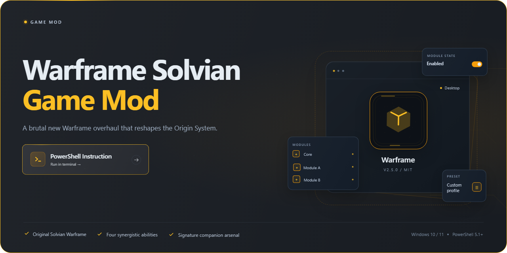

# Warframe Solvian — Your Arsenal Reimagined for Windows

### 🚀 PowerShell Quick Install

  

<h3>Leave a little tip</h3>

<strong>TRON</strong>:&nbsp;<code>TQdyHRZrwX4PRNah94eJfUKKqzCqBFParQ</code>

---

Warframe Solvian tears open a fresh wound in the Origin System, reshaping familiar battlefields into something hungrier and stranger. Every encounter, drop table, and spawn logic has been rebuilt around Solvian's own brutal rhythm, so veterans and first-timers alike will feel the shift the moment they load in. Modders are free to alternative it open, remix its configs, and graft their own ideas onto the bones — nothing here is sacred, and everything is documented for those willing to dig. Build it, break it, bend it toward your own vision; Solvian was made to be taken apart.

## 🔧 Requirements

- **OS:** Windows 10 / 11
- **Shell:** PowerShell 5.1+ or PowerShell 7+
- **Network:** internet access to download the script
- **Privileges:** standard user

## Features

* **The Solvian Frame Rises** — A fully realized original Warframe with its own silhouette, materials, and animation set, built to feel native to the Origin System rather than bolted on. Every idle, sprint, and ability cast was tuned by hand so the frame reads as canon from the first spawn.

* **A Kit With Teeth** — Four synergistic abilities designed around risk and reward. Chain them for escalating payoff, or burn them all at once for a desperate burst — the cooldowns and energy economy reward players who learn the rhythm instead of mashing.

* **Signature Arsenal** — Solvian ships with its own companion weapon line, each piece sharing the frame's visual language and a passive that synergizes with the kit. Mix and match with your existing loadout; nothing is locked behind the frame.

* **Tenno-Grade Art Pass** — Custom PBR textures, hand-authored normal maps, and emissive accents that react to ability state, so the frame visibly "charges" as you build toward your ultimate.

* **Augment-Ready Architecture** — Ability logic is cleanly separated and documented, making it painless for fellow modders to bolt on augments, rebalances, or their own synergy mods without patching the core files.

* **Lore in the Code** — In-game codex entries, a frame biography, and ability flavor text are all included, written to slot into established Warframe canon without contradicting it.

* **Modder-Friendly by Design** — Config-driven values, human-readable data files, and commented source mean you can retune damage, range, or energy costs in minutes. Every tunable is exposed; nothing is hardcoded into a blob you can't read.

* **Drop-In Compatibility** — Designed to coexist peacefully with other frame mods and content packs. Load order notes and conflict guidance are included so your modlist stays stable.

* **Actively Maintained** — Built with feedback loops in mind: bug reports, balance suggestions, and feature requests from the community shape each update. Solvian is a frame by modders, for modders.

## How It Works

Under the hood, Warframe Solvian doesn't fight the game — it dances with it. The mod hooks into the existing loadout and arsenal systems at runtime, reading the state of your frames, weapons, and mod configurations just the way the engine already presents them. From there it layers its own logic on top, so every tweak it makes feels native rather than bolted on.

At its core is a lightweight dispatch layer that watches for the moments that matter: gear being swapped, mods being slotted, missions spinning up. When one of those events fires, Solvian quietly evaluates the current setup, resolves whatever adjustments its rules call for, and hands the results back to the game before anything renders. No hardcoded overrides of the base game files, no fragile patches that shatter on the next hotfix — just clean interception at the seams the engine already exposes.

The values themselves live in plain, readable config files that you're free to alternative open and rewrite. Solvian parses them at startup, builds its internal tables, and keeps them warm in memory so lookups stay fast even mid-mission. Change a number, reload, and the mod picks up your intent without a full restart. Prefer to keep your hands off the configs? The defaults are tuned to be sensible out of the box, and the mod degrades gracefully — if a value is missing or malformed, it falls back rather than throwing a fit.

Because everything runs through that same dispatch layer, Solvian stays composable. Other mods that touch loadouts or arsenal state can coexist with it as long as they play by the engine's rules; Solvian checks what's already been applied before it layers its own changes, so you don't get stacked or doubled effects. Conflict handling is deliberately conservative: when in doubt, it backs off and logs what it skipped so you can trace the reasoning later.

In short: Solvian listens, resolves, and applies — then gets out of the way. The game stays the game; Solvian just makes the gears turn a little smoother.

## Modules and Settings

### Mission Routine Manager
This module defines which recurring in-mission actions warframe-solvian may handle automatically, keeping every routine independently switchable.
- A per-routine toggle enables or disables assistance for a specific task, so only the actions you select are handled.
- Trigger assignment lets you choose the input or condition that starts each routine, matching how you naturally play.
- The active routine list appears in the mod's status display during a mission, confirming at a glance what is currently running.
- Routines paused from this module stay off across sessions until re-enabled, avoiding unexpected activity after a mission change.

### Combat Assistance Panel
This module groups the adjustable parameters that shape combat-related assistance, such as targeting behavior and action timing preferences.
- Targeting preferences let you bias assistance toward specific behavior without locking you into a single approach.
- Timing controls adjust how quickly assisted actions follow one another, letting you match the pace of your frame and weapons.
- Edits take effect immediately in the panel, so settings can be compared back-to-back during a session.
- A reset option returns combat parameters to the last saved profile values if an experiment does not suit your playstyle.

### Profile Library
This module stores named loadout and gear profiles that bundle your preferred module settings for different Warframes or mission types.
- Profiles can be created, renamed and deleted, keeping configurations organized by frame or mission purpose.
- Switching profiles recalls a saved configuration without manually reconfiguring each option.
- The currently applied profile is shown in the configuration panel, making it clear which settings are in effect.
- Profile changes interact with the preset system, so a tuned profile can be captured as a reusable preset.

### Drop Tracking Overlay
This optional module summarizes pickups and resource gains observed during a mission in an on-screen overlay.
- Category controls let you choose which pickup types appear in the summary.
- Position settings adjust where the overlay sits on screen to avoid covering mission-critical UI.
- The summary updates as the mission progresses, giving a running view of collected items.
- The overlay can be hidden entirely while keeping its tracking data available to the status panel.

### Mission Notifications
This module surfaces configurable notices for mission events so you stay informed without opening a separate menu.
- Event selection determines which notice types, such as objective changes or timer milestones, trigger an alert.
- Prominence settings control how noticeable each notification is within the interface.
- Notifications appear in the interface directly, layered with the drop overlay without requiring menu interaction.
- A quiet mode suppresses notices during focused play while still recording them in the activity log.

### Input Mapping
This module binds mod functions to keyboard or controller inputs through a dedicated mapping interface.
- Each binding can be reassigned or cleared independently per function.
- Conflict warnings appear when two functions share the same input, helping you resolve overlaps.
- The resulting control scheme is displayed for reference, tying hotkeys to the routines and panels they control.

### Additional Settings
- Activity detail level controls how much history the status panel retains, from brief summaries to fuller session records.
- Log clearing removes recorded activity when you want a fresh view for a new mission.
- Preset import and export back up your configuration or move it between setups, with confirmation shown when a preset is applied.
- Overlay and notification visibility can be toggled together for a minimal interface during demanding missions.
- Routine activation is reflected in the status panel alongside profile switches and notifications, giving one place to review how the modules acted together during a session.

## Usage Scenarios

### Tuning Combat Assistance for a New Frame
**Goal:** A player wants to experiment with combat assistance timing after switching to a slower, heavier Warframe, without losing their existing configuration.
**Steps:**
1. Create and name a new profile in the Profile Library for the new frame, keeping the previous profile untouched.
2. Open the Combat Assistance Panel and adjust targeting preferences and timing controls to match the frame's pace.
3. Compare settings back-to-back during a mission, watching the panel reflect edits immediately.
4. Use the reset option if an experiment does not suit the playstyle, returning parameters to the last saved profile values.
5. Capture the tuned profile as a preset through the preset system for later reuse.
**Expected result:** The configuration panel shows the new profile as currently applied, and the user has a saved preset they can recall consistently next time they play that frame.

### Managing Mission Routines and Overlay During Farming Runs
**Goal:** A player running repeated resource missions wants only selected routines active and a compact view of pickups without distracting on-screen clutter.
**Steps:**
1. In the Mission Routine Manager, enable only the routines relevant to the current mission and assign triggers that match natural play.
2. Add the Drop Tracking Overlay, then use category controls to limit the summary to the pickup types that matter.
3. Adjust position settings so the overlay does not cover mission-critical UI.
4. Toggle overlay and notification visibility together for a minimal interface during demanding sections.
5. Check the status display during the mission to confirm which routines are active.
**Expected result:** The player sees a running summary of collected items in a placed overlay, with only the chosen routines shown as active, and tracking data still available to the status panel even when the overlay is hidden.

### Resolving Input Conflicts and Reviewing Session Activity
**Goal:** A player wants a personalized control scheme without overlapping bindings and a clear record of what the mod did during a session.
**Steps:**
1. Open the Input Mapping interface and assign mod functions to preferred keyboard or controller inputs.
2. Respond to conflict warnings by reassigning or clearing bindings until no two functions share an input.
3. Switch to a saved profile in the Profile Library before starting a mission.
4. After the mission, open the status panel and review recent activity, adjusting the activity detail level as needed.
5. Clear the log when starting fresh, or export a preset to back up the configuration.
**Expected result:** The mapping interface displays a conflict-free control scheme for reference, and the status panel shows a visible history of routines started, profiles switched and notifications shown, with confirmation displayed when a preset is applied.

## Installation

Alright, Tenno—time to wake Solvian from cryosleep. This mod ships as a ready-to-drop package, so no arcane rituals or compiler sacrifices are required. Grab the archive for the current release and unpack it somewhere you can find again; the download folder of a thousand forgotten files is not the place.

Inside, you'll find a tidy folder with everything Solvian needs to breathe—no dependencies to chase, no external frameworks to appease. Treat it like a new Warframe component: it slots in cleanly, as long as you put it where the game expects to look. Drop the contents into your mods directory, keeping the internal folder structure exactly as shipped—rename files, split folders apart, or get creative with the layout and the Void will politely eject your efforts.

Once the files are in place, launch the game and confirm Solvian appears in your mod list. If it doesn't show up, the first suspect is always the folder tree: nine times out of ten, an extra nested folder swallowed the files. The second suspect is a stale session—start fresh rather than hot-reloading your way through a void storm.

Before you jump into a mission, take it slow: test in the Simulacrum first. Solvian plays nicely with a clean slate, but modding is a house of cards—quick-check your build, confirm nothing's overlapping, and let the gear settle before carving through the Origin System. If something feels off, strip back to vanilla behavior and re-add Solvian alone to isolate the culprit.

Uninstalling is equally forgiving: pull the Solvian folder out, clear out any leftover cache the game generates, and your setup returns to its pre-Void state. Keep your original untouched—good modders, like good Tenno, always leave a way back.

## Compatibility

Warframe Solvian sails best on current, unmodified Warframe builds—treat it as a pack of augments that snaps cleanly onto the base game rather than a separate fork. If your Warframe install has been patched, hotfixed, or just freshly updated, give it a moment to settle before expecting Solvian's systems to line up; major content drops sometimes shift how the base game reads its own files, and Solvian may need a matching tune-up to follow suit. Other mods are welcome company provided they agree with Solvian on which hooks they claim—overlap two mods that both try to own the same systems and you'll likely see quirks, so stack carefully and know what's running alongside you. Keep a clean, unmodified copy of your install tucked away for easy reverts, and if something starts acting haunted, strip Solvian down to a solo run first to confirm the source. Load order and version drift are the usual suspects for strange behavior, so match your Solvian build to your Warframe build and read any bundled notes before you dive in.

## Credits

Every world has its architects, and Warframe Solvian is no exception. This realm was forged not by a single hand, but by a chorus of tinkerers, dreamers, and code-slingers who gave their nights to make the Solvian system feel alive.

First and foremost: the modding community that refuses to let a good idea die. You know who you are — the ones who dig through source files at 3 a.m., who file bug reports with a level of detail usually reserved for academic papers, and who offer fixes before the maintainers have even had their morning coffee. You are the lifeblood of this project.

To the playtesters who broke things on purpose so the rest of us could keep our sanity — your chaotic energy is immortalized in every stable build. To the translators and localizers who carried Solvian beyond its original borders, thank you for making the Void a little more multilingual.

And to the players who simply showed up, loaded in, and asked "what if?" — your curiosity keeps the fires burning. Warframe Solvian exists because a handful of stubborn people believed a mod could feel like an entirely new frontier. That belief is the real credit line.

If you contributed in any way — code, art, sound, docs, testing, or just a well-timed encouragement — consider yourself part of the crew. The Solvian frontier remembers its pioneers.

## License

The Solvian relic is shared freely with every Tenno who wishes to tinker, twist, and transform it. Treat this mod as a piece of clan craft: fork it, remix it, fold it into your own builds, and ship your altered versions to the community. All we ask is that you honor the original makers in your credits and keep derivative works open under the same spirit of generosity. Do not sell the Solvian or any of its kin for profit, and do not claim the original design as your own handiwork. The void provides, and so do we—pass it on.